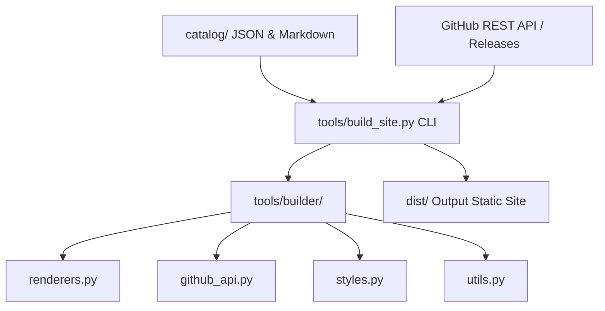
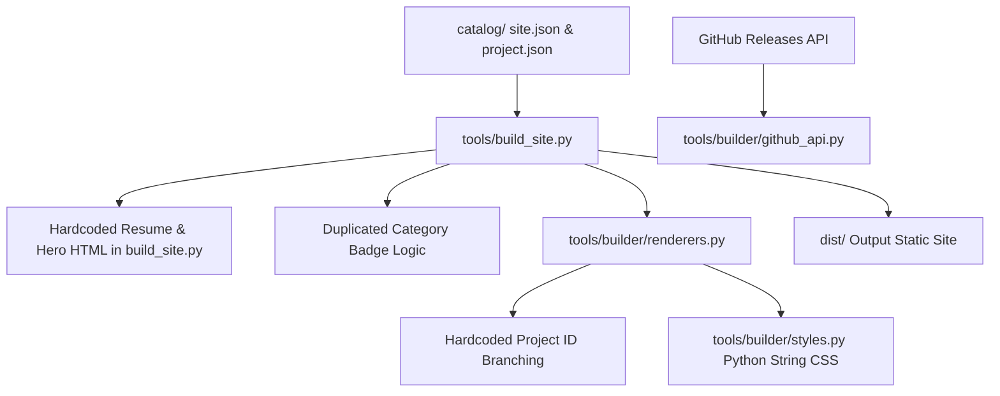

# Architecture Assessment Notes: ervivekumrao.github.io

## Scope and Context
- **Repository Root**: `H:/GitHubProjects/ervivekumrao.github.io`
- **Application Type**: Python-based Static Site Generator (SSG) & GitHub Pages App Portfolio Hub.
- **Primary Goals**:
  - Automatically generate static HTML/CSS portfolio and app hub from catalog metadata (`catalog/`) and GitHub Releases API (`manifest.json` assets).
  - Provide enterprise-grade DPM (Device Policy Manager) provisioning QR codes, binary checksum verification (SHA-256), release histories, and project detail pages.
  - Serve as the centralized release distribution hub for Android apps built via reusable CI/CD workflows (`android-release.yml`).
- **Target Audience / Stakeholders**: Enterprise clients, recruiters, open-source developers, Android app users.
- **Assessment Depth**: Standard
- **Assessment Mode**: Assess + propose (propose patches under `architecture-assessment/patches/`)

## Declared vs Actual Architecture

### Declared Architecture
A clean, modular Python static site builder package (`tools/builder/`) backed by CLI entrypoint (`tools/build_site.py`), decoupled content catalog (`catalog/`), unit test suite (`tests/`), and GitHub Actions workflows (`.github/workflows/`).

### Actual Architecture & Discrepancies

### Key Gaps Identified
1. **Presentation & Content Leakage**: `tools/build_site.py` contains over 160 lines of hardcoded HTML resume/hero content (`hero_html`, `exp_html`, `comp_html`).
2. **Duplicated Business Logic**: Category badge determination logic is duplicated between `build_site.py` and `renderers.py`.
3. **Hardcoded Project IDs**: General rendering functions in `build_site.py` and `renderers.py` contain hardcoded ID strings (`agenticinventory`, `spindb`, `jitforge`, `tomcatvault`).
4. **Synchronous I/O Bottleneck**: `github_api.py` sequentially fetches release manifests via `urllib.request.urlopen` without parallel request handling.
5. **CSS as Python String**: CSS is defined as a Python string constant in `styles.py` rather than a standard CSS asset or template.

## Critical Journeys

### Journey 1: Site Build Pipeline (Offline / CI)
1. `tools/build_site.py` executed with `--out dist` (or `--fixture`).
2. Loads `catalog/site.json` and parses project files from `catalog/projects/*/project.json`.
3. Fetches release manifests from GitHub Releases API via `tools/builder/github_api.py`.
4. Groups manifests by `app_id` and sorts by `version_code`.
5. Renders individual project pages via `render_project()` into `dist/<pid>/index.html`, copying assets and generating `icon_tab.svg`.
6. Generates index page (`dist/index.html`) combining hero section, experience timeline, competencies, and category-filtered cards.
7. Writes API catalog (`dist/api/catalog.json`) and stylesheet (`dist/style.css`).

### Journey 2: Android App Release & Site Deployment
1. External Android App Repository triggers `.github/workflows/android-release.yml@main`.
2. Workflow compiles APK, zip-aligns, signs with release keystore, computes SHA-256 and certificate fingerprints.
3. Generates `manifest.json` and uploads assets to `ervivekumrao.github.io` Releases (`<app-id>-latest` and `<app-id>-v<version>`).
4. Triggers `.github/workflows/site.yml` via GitHub API `workflow_dispatch`.
5. `site.yml` runs `pytest tests/`, executes `python tools/build_site.py --out dist`, and deploys to GitHub Pages.
