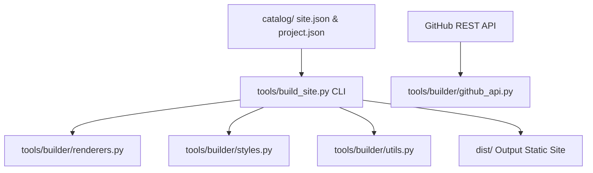
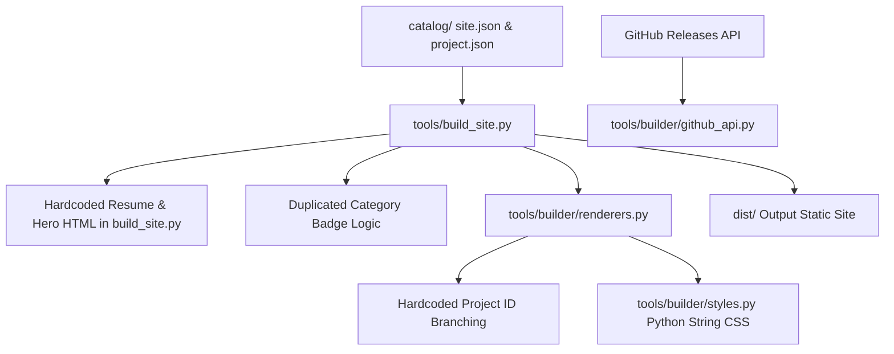

# Principal Architecture Assessment: ervivekumrao.github.io

**Target Repository**: `H:/GitHubProjects/ervivekumrao.github.io`  
**Assessment Date**: March 2025  
**Assessed By**: Principal Software Architect  
**Assessment Depth**: Standard (Full Static Codebase Analysis & Reusable Workflows Audit)  
**Assessment Mode**: Assess + Propose  

---

## 1. Executive Summary

### Overall Health Rating: B+ (Good Structural Foundation, Minor Refactoring Required)
The `ervivekumrao.github.io` repository is a lightweight, zero-dependency (or low-dependency) Python-based Static Site Generator (SSG) and enterprise release distribution hub. It elegantly automates the generation of an online engineering portfolio and Android App Store hub backed by GitHub Pages and GitHub Releases API. 

The architecture features strong security practices (SHA-256 cryptographic verification of APK downloads, Android Device Owner DPM provisioning QR codes, and automated secret cleaning in CI/CD). However, several architectural coupling issues hinder maintainability and content evolvability.

```
+-------------------------------------------------------------------------+
|                         SYSTEM ARCHITECTURE HEALTH                      |
|                                                                         |
|  [Layering & Modularization]   ██████████████░░░░  70% (Content Leakage)|
|  [Security & Cryptography]     ██████████████████  95% (Strong Signings)|
|  [Build & Release CI/CD]       ████████████████░░  85% (Automated)     |
|  [Testing & Quality Gates]     ██████████████░░░░  70% (Needs E2E)     |
|  [Scalability & I/O Performance]██████████████░░░░  75% (Sequential I/O) |
+-------------------------------------------------------------------------+
```

### Key Strengths to Protect
1. **Zero-Cost Deployment & Clean Release Pipeline**: Automated integration between Android app build workflows (`android-release.yml`) and GitHub Pages deployment (`site.yml`) via GitHub API `workflow_dispatch`.
2. **Enterprise Mobile Security Integrations**: Out-of-the-box support for Android Device Policy Manager (DPM / Device Owner) enrollment via 6-tap factory-reset QR code generation using `segno`.
3. **Cryptographic Binary Integrity**: Every binary download card displays binary SHA-256 and signing certificate SHA-256 fingerprints directly to the end user.
4. **Theme Continuity & Responsive Design**: Fast, responsive dark/light mode CSS design system with local storage persistence and system preference detection.

### Top 4 Architectural Risks (Business & Engineering Impact)
1. **Content & Presentation Leakage (ARCH-01)**: Over 160 lines of resume, experience, and competency HTML strings are hardcoded directly inside `tools/build_site.py`. Any update to job history or technical skills requires editing Python source code.
2. **Duplicated Business Logic & Hardcoded Project IDs (ARCH-02, ARCH-03)**: Project category mapping logic is duplicated across `build_site.py` and `renderers.py`, with hardcoded `if pid == "..."` branches for specific project IDs.
3. **Asset Encapsulation Violation (ARCH-04)**: The 225-line CSS stylesheet is defined as a Python multi-line string variable in `tools/builder/styles.py`, preventing standard IDE CSS syntax highlighting, linting, and external asset minification.
4. **Synchronous Network Bottleneck (ARCH-05)**: GitHub API release manifests are fetched sequentially in a single-threaded loop, causing linear `O(N)` network latency delays as release history expands.

### Recommended Direction
Decouple portfolio content into catalog JSON files (`catalog/profile.json`), centralize category badge mapping into `utils.py`, move CSS to a standalone `static/style.css` asset, add full end-to-end integration tests, and introduce defense-in-depth header sanitization for API network calls.

### Headline Investment Estimate
- **Effort Required**: ~1.5 to 2 engineering days.
- **Risk of Refactoring**: Low (Zero downtime, fully backwards compatible static site generator output).

---

## 2. Architecture Assessment

### 2.1 Declared vs Actual Architecture

#### Declared Architecture
The project presents itself as a modular Python package (`tools/builder/`) where `build_site.py` serves as a lightweight driver invoking separate modules for API fetching (`github_api.py`), HTML rendering (`renderers.py`), styling (`styles.py`), and utilities (`utils.py`).



#### Actual Architecture (Observed Reality)


---

### 2.2 Deep-Dive Assessment by Dimension

#### Dimension 1: Layering and Boundaries
- **Observed State**: `tools/build_site.py` acts both as CLI controller and content template renderer. Lines 155–322 contain embedded HTML markup for the hero section, experience history, and skills matrix.
- **Violation**: Presentation and content layers leak into the application controller layer.
- **Evidence**: `tools/build_site.py:155-322`
```python
    hero_html = f"""<div class="hero-box">
<div style="display:flex;gap:2rem;align-items:center;flex-wrap:wrap">
  <div style="flex:1;min-width:280px">
    <h1 style="margin:0 0 0.75rem 0;font-size:2.5rem;letter-spacing:-0.03em">Hi, I'm Vivek Umrao.</h1>
```

#### Dimension 2: Dependency Direction, Cycles, & Coupling
- **Observed State**: Category badge mapping logic is duplicated between `build_site.py:65-75` and `renderers.py:183-193`. Both files also contain explicit string matches for project IDs `agenticinventory`, `spindb`, `jitforge`, and `tomcatvault`.
- **Violation**: Tight coupling to specific dataset instances (hardcoded project IDs) and DRY violation.
- **Evidence**: `tools/builder/renderers.py:183-193`
```python
        if pid == "agenticinventory":
            cat_badge = "⚡ Microservices & AI"
        elif pid == "spindb":
            cat_badge = "🛠️ Developer CLI"
```

#### Dimension 3: Scalability, Performance, & Concurrency
- **Observed State**: `tools/builder/github_api.py:18-35` iterates sequentially page-by-page and release-by-release using synchronous `urllib.request.urlopen`.
- **Violation**: Unbounded linear latency growth as release assets accumulate.
- **Evidence**: `tools/builder/github_api.py:22-31`
```python
        for rel in rels:
            asset = next((a for a in rel.get("assets", []) if a["name"] == "manifest.json"), None)
            if asset:
                out.append(http_json(asset["browser_download_url"]))
```

#### Dimension 4: Security Architecture & Data Protection
- **Observed State**: `http_json` accepts an optional `token` and attaches `Authorization: Bearer <token>`. Python `urllib` follows HTTP redirects automatically.
- **Violation**: Potential risk of leaking Bearer tokens if redirected to third-party domains.
- **Evidence**: `tools/builder/github_api.py:10-14`
```python
def http_json(url: str, token: Optional[str] = None):
    headers = {"User-Agent": "app-hub-builder"}
    if token:
        headers.update({"Authorization": f"Bearer {token}", "Accept": "application/vnd.github+json"})
```

#### Dimension 5: Testing Strategy & Gaps
- **Observed State**: Unit tests in `tests/test_builder.py` test string escaping and isolated helpers, but do not execute `build_site.py` end-to-end.
- **Violation**: Missing integration coverage for full site compilation.
- **Evidence**: `tests/test_builder.py:115-136`

---

## 3. Risk Matrix

| Risk ID | Title | Likelihood | Impact | Severity | Confidence |
|---|---|---|---|---|---|
| **ARCH-01** | Hardcoded Resume & Competency Content in CLI Code | High | Medium | **High** | High (Observed) |
| **ARCH-02** | Duplicated Category & Badge Rendering Logic | High | Low | **Medium** | High (Observed) |
| **ARCH-03** | Hardcoded Project ID Conditional Branching | Medium | Medium | **Medium** | High (Observed) |
| **ARCH-04** | CSS Asset Encapsulated as Python String | High | Low | **Medium** | High (Observed) |
| **ARCH-05** | Sequential HTTP Request Loop in Release Fetcher | Medium | Low | **Low** | High (Observed) |
| **ARCH-06** | Authorization Header Leakage Risk on Redirects | Low | Medium | **Low** | Medium (Observed) |
| **ARCH-07** | Missing End-to-End Build Integration Tests | Medium | Medium | **Medium** | High (Observed) |
| **ARCH-08** | Inline Python Scripting in Reusable Actions Workflow | Low | Low | **Low** | High (Observed) |

```
                       IMPACT
             Low       Medium       High
          +----------+----------+----------+
     High | ARCH-04  | ARCH-01  |          |
LIKELIHOOD| ARCH-02  |          |          |
          +----------+----------+----------+
   Medium | ARCH-05  | ARCH-03  |          |
          |          | ARCH-07  |          |
          +----------+----------+----------+
      Low | ARCH-08  | ARCH-06  |          |
          +----------+----------+----------+
```

---

## 4. Refactoring Roadmap

```
PHASE 1: Immediate Hygiene & Refactoring (Now)
├── ARCH-02 & ARCH-03: Centralize category badge logic in utils.py (Patch 001)
├── ARCH-06: Add Bearer token domain check to http_json (Patch 003)
└── ARCH-07: Add E2E build_site.py integration tests (Patch 004)

PHASE 2: Content & Asset Decoupling (Next)
├── ARCH-01: Extract resume/experience content into catalog/profile.json (Patch 002)
└── ARCH-04: Move CSS string from styles.py to static/style.css

PHASE 3: Infrastructure Modernization (Later)
├── ARCH-05: Add ThreadPoolExecutor parallel fetching to github_api.py
└── ARCH-08: Extract workflow inline Python script to tools/generate_manifest.py
```

---

## 5. Prioritized Action Plan

| ID | Title | Scope | Effort | Risk | Acceptance Criteria | How to Verify |
|---|---|---|---|---|---|---|
| **ACT-01** | Centralize Category Badge Resolution | `tools/builder/utils.py`, `build_site.py`, `renderers.py` | 1 hour | Low | No duplicated `cat_badge` logic; supports `category_badge` in `project.json` | `pytest tests/` |
| **ACT-02** | Add E2E Integration & Fitness Tests | `tests/test_builder.py` | 1 hour | Low | `build_site.main()` executed in test suite under temp directory | `pytest tests/` |
| **ACT-03** | Sanitize Bearer Auth Tokens in HTTP Client | `tools/builder/github_api.py` | 30 mins | Low | Exception raised if `token` is sent to non-api.github.com host | `pytest tests/` |
| **ACT-04** | Decouple Resume Content into `catalog/profile.json` | `catalog/profile.json`, `tools/build_site.py`, `renderers.py` | 2 hours | Low | `build_site.py` contains 0 lines of hardcoded resume HTML | Run `python tools/build_site.py` & verify `dist/index.html` |
| **ACT-05** | Externalize CSS File to `static/style.css` | `static/style.css`, `tools/builder/styles.py` | 1 hour | Low | CSS stored in `static/style.css` with IDE syntax highlighting | Compare generated `dist/style.css` |

---

## 6. Appendices

### Appendix A: Proposed Patches (Ready to Apply)
The following reviewable patches have been generated under `architecture-assessment/patches/`:
1. `architecture-assessment/patches/001-extract-category-and-titles-helper.diff`
2. `architecture-assessment/patches/002-decouple-resume-content-from-cli.diff`
3. `architecture-assessment/patches/003-security-bearer-token-validation.diff`
4. `architecture-assessment/patches/004-add-end-to-end-integration-tests.diff`

### Appendix B: Architectural Decision Record Draft (ADR-0001)

#### ADR-0001: Decoupling Resume Content and Presentation Metadata from Executable Generator Code
- **Status**: Proposed
- **Context**: `tools/build_site.py` contains 160+ lines of hardcoded HTML representing personal portfolio resume content, experience history, and core competency groups.
- **Decision**: Extract all resume and profile metadata into `catalog/profile.json` and `catalog/experience.json`. Extend `tools/builder/renderers.py` to render these sections declaratively.
- **Consequences**:
  - *Positive*: Complete separation of content and code; non-developers or automated scripts can update profile metadata; Python code remains clean and maintainable.
  - *Negative*: Adds two new catalog JSON files to maintain.

---

## Conclusion & Next Steps
This architecture assessment confirms that `ervivekumrao.github.io` is a solid, well-built platform with high cryptographic security standards. Implementing the proposed refactoring patches will resolve content leakage, eliminate duplicate code, and ensure long-term evolvability.
